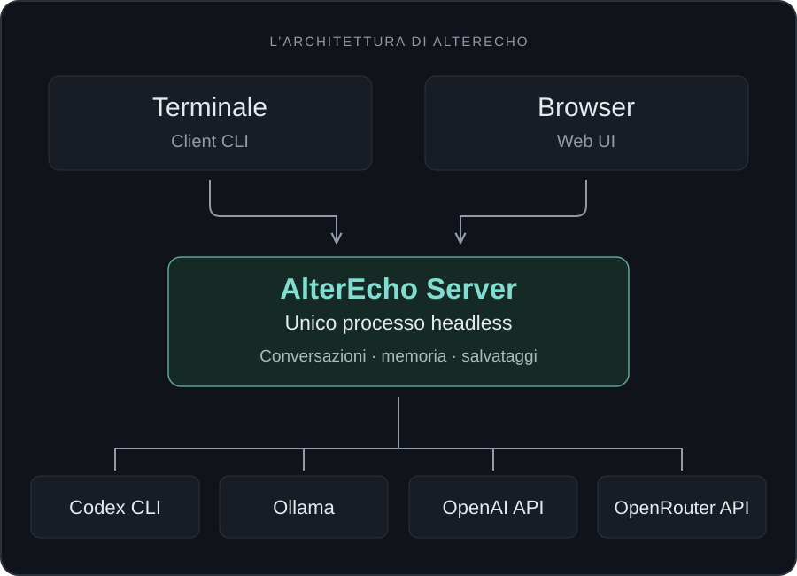

# Architettura AlterEcho 1.1

## Un solo processo applicativo



`alterecho serve` è l'unica modalità che possiede il motore. Primo piano, servizio e container avviano lo stesso programma. `cli.py` e `client.py` non importano coordinatore o adapter; `serve` carica FastAPI solo quando richiesto. `profile_runtime.py` contiene la factory degli adapter, non un secondo ciclo operativo. Anche `demo` passa dal server.

## Organizzazione

Dalla 1.1 `serve` avvia il processo detached e verifica readiness autenticata e identità dell’istanza; `serve --foreground` esegue direttamente Uvicorn per diagnostica e supervisori. `managed.py` serializza i comandi locali con un lease, gestisce log e metadati riservati e un canale TCP loopback autenticato distinto da HTTP. `down` richiede shutdown solo a quell’istanza; non invia segnali a un PID memorizzato e non esiste un endpoint pubblico di spegnimento. Il watchdog arresta gli avvii che il launcher non ha potuto confermare. Le lease applicative e il lifespan rimangono gli stessi in entrambe le modalità.

| Modulo | Responsabilità |
| --- | --- |
| `cli.py`, `client.py`, `ui.py` | Parser, client HTTP/SSE, menu Rich e preferenze remote |
| `managed.py`, `watching.py` | Ciclo del processo locale verificato e rendering Rich incrementale deduplicato |
| `server.py`, `server_settings.py` | API, statici, autenticazione, origini/host fidati, lease e ciclo del servizio |
| `api_models.py` | Contratti Pydantic stretti, interlocutori A/B e limiti degli input |
| `sessions.py` | Proprietà delle attività, stato, ripresa, diagnostica, checkpoint e snapshot |
| `coordinator.py` | Unico ciclo di alternanza; nessuna dipendenza da Rich |
| `events.py` | Eventi serializzabili e replay ordinato con epoch del processo |
| `profile_runtime.py`, `integrations.py` | Factory estensibile, catalogo e snapshot dei profili |
| `adapters/` | Protocollo comune, Codex stdio, Ollama NDJSON, OpenAI/OpenRouter SSE |
| `history.py`, `preferences.py`, `paths.py` | Memoria canonica, configurazione compatibile e percorsi |
| `storage.py`, `stats.py`, `exporters/` | Scrittura atomica, statistiche, export MD/TXT/HTML autonomo |
| `security.py`, `migration.py` | Redazione degli errori e migrazione esplicita con hash |
| `web/src/`, `alterecho/static/` | Sorgente Svelte/TypeScript e build servita da Python |
| `deploy/`, `Dockerfile`, `compose.yaml` | Esempi di servizi, reverse proxy, standalone e container |
| `tests/`, `.github/workflows/` | Regressioni, mock, SSE su socket e matrice CI |

## Ciclo e consistenza

Il SessionManager registra immediatamente una task indipendente dalla richiesta HTTP; la disconnessione non cancella la task. Un lock serializza creazione/ripresa e vieta l'avvio concorrente sullo stesso ID. Un lease del sistema operativo protegge directory dati e cartella principale degli storici da altri processi. è vietato avviare più worker; il limite iniziale è quattro conversazioni attive. Gli ID duplicati in più file vengono segnalati, non scelti arbitrariamente.

Le conversazioni conservano `schema_version=1`, messaggi, sessione Codex, pending e partial. La lettura non migra retroattivamente i file. Per compatibilità i JSON continuano a usare gli slot `codex` e `ollama`; gli endpoint pubblici, i messaggi e gli eventi usano A e B. Il campo provider è separato nello snapshot del profilo. Un provider API nello slot A non modifica i checkpoint nativi Codex.

Una nuova conversazione parte dai profili registrati sul server; i client possono selezionare solo ID e modello, non un eseguibile o un percorso. La ripresa usa i profili salvati nello storico, non quelli eventualmente modificati nel catalogo. Prima della ripresa viene creato un backup del JSON; Codex verifica il thread e può recuperare una risposta remota completata ma non ancora impegnata nel JSON. Il coordinatore aggiunge un messaggio solo dopo una risposta completa. Errori di limite, strumenti o stream incompleto conservano il parziale senza inoltrarlo.

Il checkpoint `pending.turn_id` viene impegnato insieme al messaggio completo. Il recupero Codex preesistente impedisce duplicazione di contesto/risposte e rifiuta modifiche esterne o turni incompleti non verificabili. I provider HTTP ricostruiscono la memoria dai soli messaggi completi; i parziali precedenti restano nel backup. Non si tenta una ripresa automatica dopo un crash.

`pause` chiede la sospensione al confine fra turni; `stop` cancella la task e preserva il parziale. Uvicorn chiude tramite lifespan, che cancella ordinatamente le task, chiude i provider e salva/esporta. La chiusura di un client non esegue questo percorso. Lo stato di task e le prenotazioni dei thread vengono rilasciati anche se un export fallisce.

## Eventi e streaming

Eventi: `conversation.created`, `started`, `stopped`, `completed`, `failed`, `paused`, `resumed`; `turn.started`; `message.delta`; `message.completed`; `stats.updated`. Ogni evento contiene ID `epoch:sequence`, tipo, ID conversazione, timestamp e dati JSON. Le notifiche non contengono token, ambiente, stderr completo o oggetti RPC interni.

Il callback checkpoint conserva la firma precedente e offre un metodo `delta`: gli adapter lo chiamano quando ricevono un vero frammento dal provider. Il coordinatore non suddivide risposte complete per simulare lo streaming. I checkpoint su disco mantengono la cadenza prudente degli adapter; il messaggio finale viene salvato atomicamente prima della notifica di completamento.

Ogni conversazione ha un replay circolare di 2048 eventi e un segnale asyncio. Non ci sono code illimitate per client lenti. SSE rispetta `Last-Event-ID`; cursor assente/scaduto o epoch precedente produce `state.snapshot` con messaggi, parziale e stato attuali. La lettura dello snapshot e del cursor è atomica rispetto al loop asyncio. I client applicano i completamenti per indice e possono riconnettersi. I checkpoint JSON sono durevoli; il replay non è un event store su disco.

## API v1

Documentazione autenticata in `/api/v1/docs` e `/api/v1/openapi.json`.

| Endpoint | Funzione |
| --- | --- |
| `GET /health`, `/version`, `/status` | Liveness minimale, versione, servizio e attività |
| `GET /providers`, `/profiles`, `/models` | Provider, profili e cataloghi precedentemente verificati |
| `POST /doctor` | Consulta cataloghi senza generare, preparare modelli o scaricarli |
| `GET/PUT /settings`, `GET/PUT /profiles` | Preferenze condivise e profili senza valori delle chiavi |
| `GET /conversations`, `/history` | Elenco con ricerca e filtri stato/provider |
| `POST /conversations` | Avvio asincrono, risposta 202 con ID |
| `GET /conversations/{id}` | Snapshot coerente e statistiche |
| `POST .../preflight`, `.../resume` | Verifica senza riscrittura, poi ripresa esplicita |
| `POST .../pause`, `.../stop` | Pausa al confine del turno, arresto immediato |
| `GET .../events`, `.../stats` | SSE e statistiche |
| `GET .../export/{format}` | Download JSON/MD/TXT/HTML |
| `DELETE /conversations/{id}` | Elimina solo la conversazione selezionata e i suoi export, se non attiva |

Gli esempi di percorsi nella tabella sono relativi a `/api/v1`. Health è pubblico e non rivela configurazione; il resto richiede `Authorization: Bearer TOKEN`. Esempio senza consumo AI:

```sh
curl -H "Authorization: Bearer $ALTERECHO_TOKEN" http://127.0.0.1:8765/api/v1/status
curl -H "Authorization: Bearer $ALTERECHO_TOKEN" -H "Content-Type: application/json" -d '{"demo":true,"configuration":{"max_turns":2}}' http://127.0.0.1:8765/api/v1/conversations
```

## Sicurezza e risorse

Binding predefinito su loopback. Binding non locale rifiutato senza token lungo, origini esatte e host ammessi. Bearer token anche su localhost; niente cookie di sessione o token nelle query SSE. Il browser mantiene il token solo in memoria. Origin e Sec-Fetch-Site proteggono il servizio da siti terzi; CORS è ristretto, Host limita DNS rebinding. Reverse proxy HTTPS esterno con IP fidati espliciti; nessuna fiducia predefinita negli header forwarded.

Contratti Pydantic con campi extra rifiutati, corpo massimo 256 KiB, limiti sui parametri e nessuna API per shell/file arbitrari. Eseguibile Codex e directory restano sotto controllo del proprietario del server. Download tramite ID indicizzati e formato enumerato; link simbolici risolti fuori dalle radici configurate non vengono esposti. Errori di validazione non riflettono gli input; errori operativi redigono chiavi e token noti. Access log Uvicorn disabilitato. CSP, nosniff, no-referrer e frame denial sulle risposte.

Rate limit per IP: 30 scritture/minuto, 240 letture/minuto, otto stream SSE simultanei. Un token attribuisce diritti amministrativi completi; non è un sistema multiutente. Proteggere i file di token con permessi/ACL dell'account del servizio. HTTPS/VPN sono necessari su trasporti non fidati.

Codex mantiene forced ChatGPT login, strict config, strumenti/MCP/app/plugin disabilitati, verifica degli eventi RPC e nessuna shell per i prompt. Le chiavi API e il token AlterEcho vengono rimossi dall'ambiente del figlio Codex. Gli adapter HTTP usano endpoint ufficiali per OpenAI/OpenRouter, niente redirect né proxy ambientali e rifiutano richieste di strumenti. Ollama richiede loopback o allowlist dell'ambiente server; keep_alive e politica conservativa di unload sono preservati.

## Frontend e distribuzione

La conversazione è separata in `ConversationView` e `MessageBubble`: colonna centrale, header compatto, dettagli espandibili, identità stabili per indice del messaggio durante delta e completamento. Il Markdown viene ricalcolato solo quando cambia il testo della singola bolla. `requestAnimationFrame`, `tick` e `ResizeObserver` coordinano lo scroll dopo il layout; l’interazione manuale disabilita il follow e una freccia lo riattiva. Le posizioni rimangono in memoria nella sessione browser. Le riconnessioni recuperano snapshot e cursore insieme via SSE; un GET attivo senza cursore non viene sommato al replay.

`ModelSelector` legge solo i cataloghi dei profili registrati; cataloghi vuoti, indisponibilità e valori rimossi sono visibili senza sostituzioni automatiche. `ConfirmDialog` usa un dialogo HTML modale con focus iniziale su Annulla, focus contenuto, Escape e ripristino del focus. `Toast` gestisce notifiche non bloccanti. Il consenso ai provider a consumo resta distinto dall’apertura della modale e il server lo verifica di nuovo.

Svelte 5, Vite e TypeScript compilano in `alterecho/static`. Dashboard, creazione, configurazione, profili, cronologia, conversazioni, SSE e download usano gli stessi endpoint della CLI. Markdown viene renderizzato con HTML disabilitato e DOMPurify, senza immagini remote o schemi di link attivi. Tema chiaro/scuro e layout responsive non richiedono Electron/Tauri o un ambiente grafico sul server. Gli export HTML usano invece il renderer Python preesistente con risorse incorporate e CSP a hash.

Wheel e sdist includono gli statici. L'extra `server` installa FastAPI/Uvicorn/Pydantic; il client può essere installato senza quelle dipendenze. PyInstaller usa la medesima entrypoint. Il Dockerfile compila la UI in uno stage Node, costruisce wheel in uno stage Python e usa un runtime non root. Lo stato Codex è in un volume distinto. Servizi systemd/launchd/WinSW avviano lo stesso comando con home persistente esplicita.

Le verifiche e i limiti realmente osservati sono riportati in [docs/VERIFICA.md](docs/VERIFICA-1.1.md); non implicano l'esecuzione di CI o inferenze reali. Le fonti ufficiali consultate includono [FastAPI lifespan](https://fastapi.tiangolo.com/advanced/events/), [Svelte TypeScript](https://svelte.dev/docs/svelte/typescript) e [Codex authentication](https://learn.chatgpt.com/docs/auth).
