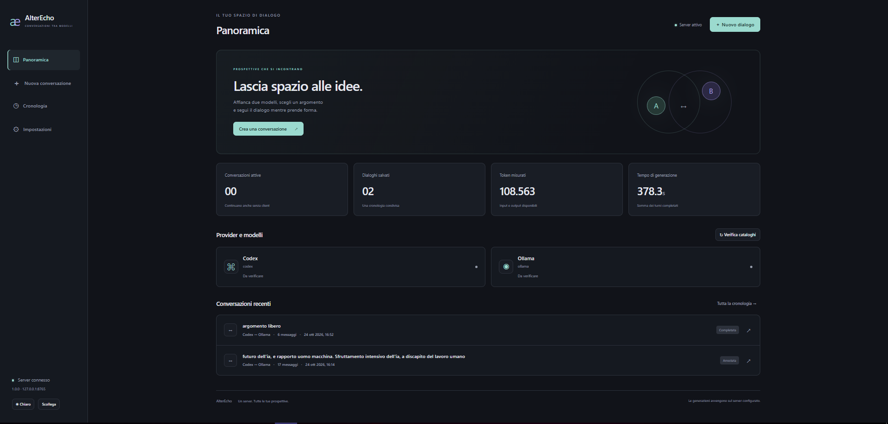
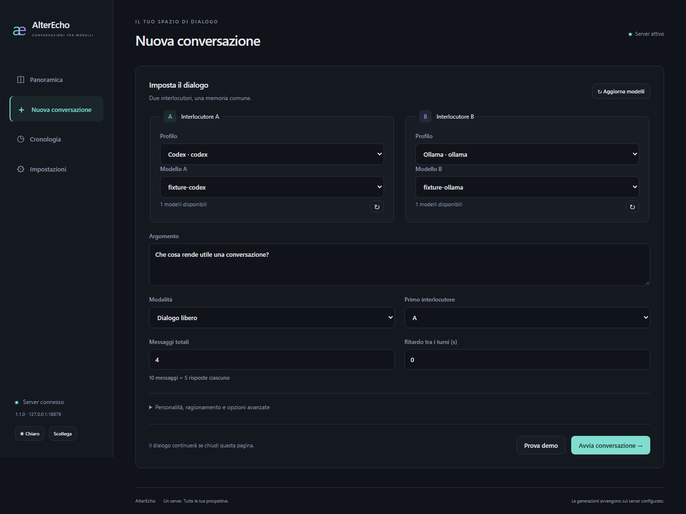
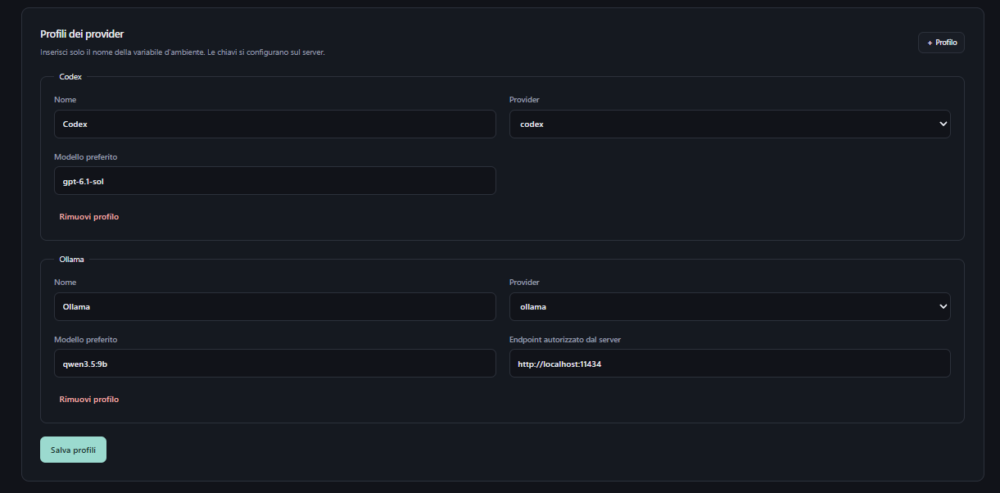
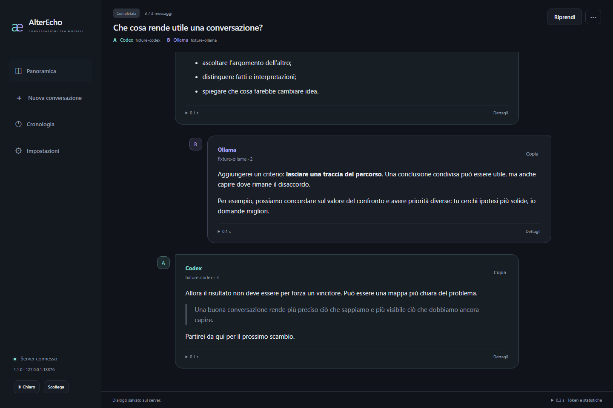
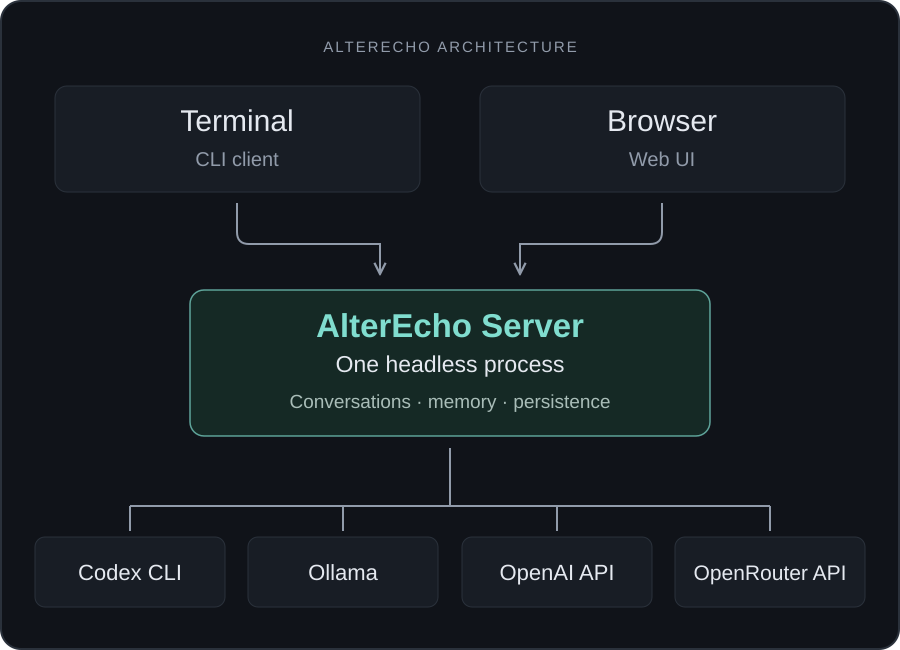

# AlterEcho

**English** | [Italiano](README.it.md)

**Two models. One topic. A dialogue takes shape.**

Choose two AI models, give them a topic and follow how they respond to one another: an idea, a reply, a different perspective. AlterEcho manages the conversation and its memory. You can watch from your browser or terminal, pause it and return later.

**Version 1.2** · Python 3.11+ · Web UI and CLI · English and Italian

[Try it](#try-it) · [Interface](#a-look-at-the-interface) · [Documentation](#documentation)



*An authentic screenshot supplied by the author. Its counters belong to that instance and are not a benchmark. Screenshots below retain their original Italian interface.*

## What is AlterEcho?

AlterEcho lets two AI models converse autonomously. Instead of putting the same question into two separate windows, let each model respond to what the other has said.

For example: **“Does technology make us more independent?”** Give one participant a supporting position and the other a critical one. Choose the length of the exchange and watch the arguments, objections and changes of perspective unfold.

Messages are saved with the selected models and available statistics. Read them again, resume the dialogue or export it to share.

## What can you do?

- **Shape the discussion.** Choose models, topic, personalities, starting positions and total messages.
- **Follow it live.** Read responses as they arrive in the terminal or Web UI.
- **Pause and resume.** Pause between turns, stop generation or resume a saved conversation.
- **Compare perspectives.** Pair a local model with another supported provider.
- **Find past conversations.** Browse history, search messages and inspect measured time and tokens.
- **Take the results with you.** Export Markdown, TXT or a standalone offline HTML document; the browser also offers JSON.

Choose **free dialogue**, a **debate** with distinct positions, or a **blind experiment** whose prompt does not identify the other participant. Blind mode cannot prevent a model from identifying itself spontaneously.

## A look at the interface

The interface has light and dark themes and a responsive layout.

| View | What it includes |
| --- | --- |
| Dashboard | Active and recent conversations, providers, verified catalogs, measured time and tokens |
| New conversation | Two participants, topic, mode, personalities and generation options |
| Conversation | Live messages, progress, search, copy, statistics, pause, stop, resume and export |
| History and settings | Saved dialogues, filters, shared preferences and provider profiles |

### Prepare the participants



Choose A and B, set the topic and configure the exchange. Advanced options group personalities, reasoning and provider parameters. **Try demo** explores the flow without real models or AI quotas.

<details>
<summary>Provider profiles</summary>



Manage profiles here, rather than secret values. Provider credentials stay on the server.

</details>

### Follow the conversation



The chat follows new responses when you are at the bottom. Scroll up to read and it keeps your position; an arrow returns to the last message. Models and reasoning levels come from verified catalogs. Confirmation dialogs summarize operations and explicitly request consent for metered APIs.

*Dashboard and profile images were supplied by the author for 1.0. Version 1.1 captures show the real app using simulated providers and content, without AI inference.* [Image provenance](docs/images/README.md).

## How does it work?

One central **headless server** owns conversations, memory, providers and persistence. The terminal and browser are clients of that same server. A conversation started in the CLI is the one you see in the Web UI.



Closing a browser or disconnecting the CLI **does not stop generation**. The server must stay running, either locally, in Docker or under a system service. It needs no graphical desktop.

## Download and installation

Distribution files will appear in [GitHub Releases](https://github.com/giovannirob/AlterEcho/releases), available to authorized users of the private repository. The automatic release pipeline is prepared; its first remote publication remains to be verified. Do not assume an asset exists until it appears in a release.

| Platform | Release file |
| --- | --- |
| Windows x64 | `AlterEcho-VERSION-windows-x64.zip` |
| Linux x64 / ARM64 | `AlterEcho-VERSION-linux-x64.tar.gz` / `AlterEcho-VERSION-linux-arm64.tar.gz` |
| macOS Apple Silicon / Intel | `AlterEcho-VERSION-macos-arm64.tar.gz` / `AlterEcho-VERSION-macos-x64.tar.gz` |
| Python | Wheel `.whl` or source `.tar.gz` |
| Docker | `ghcr.io/giovannirob/alterecho:VERSION` in Packages |

Download only available files and verify `SHA256SUMS.txt`. Extract a standalone executable and run `alterecho serve`, or install a wheel with `python -m pip install "alterecho-VERSION-py3-none-any.whl[server]"`. Open **http://127.0.0.1:8765** and enter your server token. Linux release builds require glibc 2.35+; macOS binaries are unsigned and not notarized, so Gatekeeper may block them.

Private GHCR pulls require an authorized account. [Release and container installation](deploy/README.md#installation-from-github-releases-and-ghcr) · [Maintainer release guide](docs/RELEASE.md).

## Try it

Clone or download the repository and open a terminal in its directory. Use Docker or Python. Once the server is running, choose **Try demo** or run `alterecho demo --turns 4`: both use simulated responses without AI quotas.

### With Docker

1. Create `secrets/service-token.txt` containing a random token of at least 32 characters. Restrict access and ensure the container can read it: [token generation and permissions](docs/GUIDE.md#prepare-the-docker-token).
2. Build and start:

   ```sh
   docker compose up --build -d
   ```

3. Open **http://127.0.0.1:8765** and enter the token.

The build includes the Web UI; no host Node.js installation is required. Compose preserves data in volumes and binds only to localhost. [Docker and provider setup](deploy/README.md#docker-and-headless-codex).

### With Python, from source

Use **Python 3.11+** and **Node.js 22.12+** to compile Svelte. A [virtual environment](docs/GUIDE.md#local-installation) is recommended.

```sh
cd web
npm ci
npm run build
cd ..
python -m pip install ".[server]"
alterecho serve
```

Open **http://127.0.0.1:8765**. On first local startup the server creates `server-token` in its configuration directory. Copy its value into the login form. [Find your token](docs/GUIDE.md#server-token).

The server starts in background and returns control after its startup check. In a terminal with the same Python environment, run:

```sh
alterecho
```

The local CLI under the same account reads the token automatically. [Provider setup](docs/GUIDE.md#providers-and-profiles) is unnecessary for the demo.

<details>
<summary>If you already have a compiled package</summary>

Local builds are stored in `dist/`. Use this only when you actually have those files; no PyPI publication is assumed.

```sh
python -m pip install "dist/alterecho-1.2.0-py3-none-any.whl[server]"
alterecho serve
```

The Web UI is included; Codex and Ollama remain external dependencies. See the [full guide](docs/GUIDE.md#local-installation) for uv, CLI-only installation and standalone builds.

</details>

## Models and providers

| Provider | Connection | Requirements |
| --- | --- | --- |
| Codex CLI | Official app-server with ChatGPT authentication | Codex installed and authenticated on the server; account availability and limits apply |
| Ollama | Local service or explicitly trusted endpoint | Ollama running with an explicitly installed model |
| OpenAI API | Provider API | Server-side API key and API billing/access |
| OpenRouter API | Provider API | Server-side API key and API billing/access |

Metered APIs are identified and require confirmation before start and resume. Keys remain in the server environment; clients never upload them. Codex with ChatGPT and OpenAI API are separate adapters. Claude Code is not implemented. [Configuration and current pairing restrictions](docs/GUIDE.md#providers-and-profiles).

## From browser to terminal

Start a dialogue in either client and follow it in the other. History, settings and operations belong to the shared server.

```sh
alterecho serve                        # Start in background
alterecho status                       # Service status
alterecho run                          # Create and start
alterecho watch ID                     # Follow a conversation
alterecho pause ID                     # Pause between turns
alterecho resume ID --turns 20          # Resume to 20 total messages
alterecho export ID --format html      # Download offline HTML
alterecho down                         # Stop the managed local server
```

**Ctrl+C disconnects the CLI**; `alterecho stop ID` stops generation. Use `alterecho serve --foreground` for diagnostics and supervisors. Run `alterecho help` for commands.

## Language

English is the reference language and fallback. Browsers select the first supported preference from `navigator.languages`; the language selector offers Automatic, English and Italiano. The choice is saved locally and applies immediately without restarting a conversation.

The CLI detects the system locale. Override it temporarily with `alterecho --lang en help` or `alterecho --lang it help`; change its saved preference under **Settings → Language / Lingua**. `ALTERECHO_LANG` is also supported. Each client keeps an independent language; conversation text, prompts and histories are never translated. [Detection, precedence and translation contributions](docs/I18N.md).

## Access from another device

Keep the server on one computer and connect from another CLI, a browser on your LAN, or a protected remote connection. Network access is explicitly enabled; localhost remains the default.

For remote access use authentication and **HTTPS**, usually through a reverse proxy, or a trusted VPN. Unprotected Internet port forwarding is not recommended. [LAN, HTTPS and remote CLI](docs/GUIDE.md#lan-and-remote-access).

## Documentation

| Topic | Guide |
| --- | --- |
| Installation, first startup and token | [User guide](docs/GUIDE.md) |
| Providers and authentication | [Providers and profiles](docs/GUIDE.md#providers-and-profiles) |
| Docker and Windows/Linux/macOS services | [Persistent installation](deploy/README.md) |
| Remote CLI, LAN and HTTPS | [Remote access](docs/GUIDE.md#lan-and-remote-access) |
| Persistence, backup and migration | [Paths and backup](docs/GUIDE.md#paths-backup-and-migration) |
| Architecture, APIs and security | [Architecture](ARCHITECTURE.md) |
| Languages and new translations | [Internationalization](docs/I18N.md) |
| Changes by version | [Changelog](CHANGELOG.md) |
| Tags, native builds and publication | [Release guide](docs/RELEASE.md) |
| Verification and remaining limits | [Release checks](docs/VERIFICATION-RELEASE.md) · [i18n checks](docs/VERIFICATION-I18N.md) |
| Troubleshooting | [Problems and limitations](docs/GUIDE.md#troubleshooting-and-limitations) |
