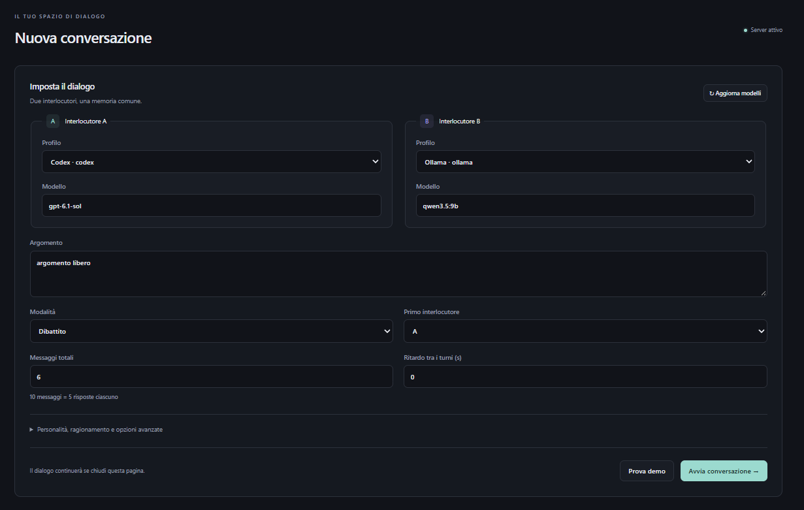

# AlterEcho

**Due modelli. Un argomento. Il dialogo prende forma.**

Scegli due intelligenze artificiali, assegna un tema e segui come si rispondono: un'idea, una replica, un nuovo punto di vista.

AlterEcho gestisce la conversazione e la sua memoria. Tu puoi osservarla dal browser o dal terminale, metterla in pausa e tornarci in seguito.

**Versione 1.0** · Python 3.11+ · Web UI e CLI

[Provalo](#provalo) · [Interfaccia](#uno-sguardo-allinterfaccia) · [Documentazione](#documentazione)


*La Web UI in tema scuro. Screenshot fornito dall'autore: i contatori mostrati appartengono a quella istanza e non sono un benchmark.*

## Che cos'è AlterEcho?

È un progetto per far conversare autonomamente due modelli AI. Invece di porre la stessa domanda a due finestre separate, puoi lasciare che ciascun modello risponda a ciò che ha scritto l'altro.

Per esempio: **«La tecnologia ci rende più autonomi?»** Puoi assegnare a un interlocutore la posizione favorevole e all'altro quella critica. Scegli la durata dello scambio e osserva quali argomenti propongono, come li contestano e se rivedono le proprie idee.

I messaggi restano salvati, insieme ai modelli scelti e alle statistiche disponibili. Puoi rileggerli, riprendere il dialogo o esportarlo per condividerlo.

## Cosa puoi farci?

- **Dare forma al confronto.** Scegli modelli, argomento, personalità, posizioni iniziali e numero di messaggi.
- **Seguire il dialogo in diretta.** Leggi le risposte mentre arrivano, dal terminale o dalla Web UI.
- **Fermarti e ripartire.** Metti in pausa tra un turno e l'altro, arresta una conversazione o riprendine una salvata.
- **Confrontare prospettive diverse.** Affianca un modello locale a uno degli altri provider disponibili.
- **Ritrovare le conversazioni.** Consulta la cronologia, cerca nei messaggi e osserva tempi e token quando forniti dal provider.
- **Portare via i risultati.** Esporta in Markdown, TXT o HTML autonomo da aprire anche offline; dal browser è disponibile anche il JSON.

Puoi scegliere un dialogo **libero**, un **dibattito** con posizioni iniziali distinte o la modalità **cieca**, in cui il prompt non esplicita l'identità dell'interlocutore. Quest'ultima non garantisce che un modello non si identifichi spontaneamente.

## Uno sguardo all'interfaccia

La Web UI usa uno stile essenziale, con tema chiaro e scuro e un layout pensato anche per schermi piccoli. Le viste disponibili sono:

| Vista | Cosa trovi |
| --- | --- |
| **Panoramica** | Conversazioni attive e recenti, provider, cataloghi verificati, tempi e token misurati |
| **Nuova conversazione** | Scelta dei due interlocutori, tema, modalità, personalità e opzioni di generazione |
| **Conversazione** | Messaggi in diretta, avanzamento, ricerca, copia, statistiche, pausa, arresto, ripresa ed export |
| **Cronologia e impostazioni** | Dialoghi salvati, filtri, preferenze condivise e profili dei provider |

### Prepara i due interlocutori



Scegli A e B, assegna il tema e imposta lo scambio. Le opzioni avanzate raccolgono personalità, ragionamento e parametri dei provider; **Prova demo** permette di esplorare il flusso senza modelli reali.

<details>
<summary>Uno sguardo ai profili dei provider</summary>


Qui gestisci i profili, non i valori delle chiavi API. Le credenziali dei provider restano sul server.

</details>

Le schermate sono autentiche e fornite dall'autore. Non è ancora inclusa una cattura dei messaggi durante una conversazione. [Provenienza e dettagli delle immagini](docs/images/README.md).

## Come funziona?

Un unico servizio centrale gestisce conversazioni, memoria, provider e salvataggi. Terminale e browser sono due interfacce dello stesso **server headless**: una conversazione avviata dalla CLI è la stessa che ritrovi nella Web UI.


Chiudere il browser o scollegare la CLI **non interrompe una conversazione in corso**. Il server deve restare acceso; puoi eseguirlo in primo piano, in Docker o come servizio di sistema. Non serve un ambiente desktop sul server.

## Provalo

Scarica o clona il repository e apri un terminale nella cartella di AlterEcho. Puoi scegliere Docker oppure un'installazione Python.

Per esplorare il programma non devi subito collegare modelli reali: dopo aver avviato il server puoi scegliere **Prova demo** nella Web UI oppure eseguire `alterecho demo --turns 4`. La demo usa risposte simulate, senza quote AI.

### Con Docker

Dalla cartella del repository, con Docker e Compose disponibili:

1. Crea `secrets/service-token.txt` con un token casuale di almeno 32 caratteri, riservato agli account autorizzati. Il file deve essere leggibile dal container: [generazione e permessi](docs/GUIDA.md#preparare-il-token-per-docker).
2. Compila e avvia il servizio:

   ```sh
   docker compose up --build -d
   ```

3. Apri **http://127.0.0.1:8765** e inserisci il token che hai preparato.

La build compila anche la Web UI: non richiede Node.js installato sull'host. Compose mantiene i dati in volumi e pubblica la porta soltanto su localhost. Per collegare Codex o Ollama, segui la [guida Docker e provider](deploy/README.md#docker-e-codex-headless).

### Con Python, dal sorgente

Servono **Python 3.11+** e **Node.js 22.12+** per compilare il frontend Svelte. Dalla cartella del repository, preferibilmente in un [ambiente virtuale](docs/GUIDA.md#installazione-locale):

```sh
cd web
npm ci
npm run build
cd ..
python -m pip install ".[server]"
alterecho serve
```

Apri **http://127.0.0.1:8765**. Al primo avvio locale il server crea `server-token` nella sua cartella di configurazione: copia quel valore nel modulo di accesso della Web UI. [Dove trovare il token](docs/GUIDA.md#token-del-server).

Lascia aperto il terminale del server. In un **secondo terminale**, usando lo stesso ambiente Python, esegui:

```sh
alterecho
```

Il client locale sullo stesso account legge automaticamente il token. La configurazione iniziale dei provider è spiegata [qui](docs/GUIDA.md#provider-e-profili); non è necessaria per la demo.

<details>
<summary>Se hai già un pacchetto compilato</summary>

Le build locali verificate producono un wheel, un archivio sorgente e uno standalone Windows in `dist/`. Usa questa strada solo se possiedi già quei file: qui non viene presupposta una release pubblica o un'installazione da PyPI.

Se hai il wheel corrispondente, puoi installarlo senza compilare il frontend:

```sh
python -m pip install "dist/alterecho-1.0.0-py3-none-any.whl[server]"
alterecho serve
```

La Web UI è già inclusa. Codex e Ollama restano dipendenze esterne. Per uv, installazioni con sola CLI e build standalone, consulta la [guida completa](docs/GUIDA.md#installazione-locale).

</details>

## Modelli e provider

AlterEcho dispone di quattro adapter. L'accesso ai modelli dipende da ciò che hai installato, dal tuo account e dai servizi configurati.

| Provider | Come si collega | Cosa serve |
| --- | --- | --- |
| **Codex CLI** | App-server ufficiale, con accesso ChatGPT | Codex CLI installato e autenticato sul server; disponibilità e limiti del proprio account |
| **Ollama** | Servizio locale o endpoint fidato | Ollama in esecuzione e un modello installato esplicitamente |
| **OpenAI API** | API del provider | Chiave sul server e relativo accesso/fatturazione API |
| **OpenRouter API** | API del provider | Chiave sul server e relativo accesso/fatturazione API |

Le API a consumo sono segnalate e richiedono conferma prima dell'avvio e della ripresa. Le chiavi restano nell'ambiente del server e non vengono trasferite dalla CLI o inserite nella Web UI. Codex con ChatGPT e OpenAI API sono due adapter distinti.

[Configurazione dei provider, autenticazione e limiti delle coppie](docs/GUIDA.md#provider-e-profili). Claude Code non è attualmente implementato.

## Dal browser al terminale

Puoi iniziare un dialogo nel browser e seguirlo dalla CLI, o fare il contrario. Cronologia, impostazioni e operazioni appartengono al server condiviso.

```sh
alterecho status                       # Stato del servizio
alterecho run                          # Crea e avvia un dialogo
alterecho watch ID                     # Segui una conversazione
alterecho pause ID                     # Sospendi tra i turni
alterecho resume ID --turns 20         # Riprendi fino a 20 messaggi totali
alterecho export ID --format html      # Scarica un HTML offline
```

Nella CLI **Ctrl+C scollega il client**; `alterecho stop ID` arresta la generazione sul server. Per la guida completa ai comandi usa `alterecho help`.

## Anche da un altro dispositivo

Puoi tenere il server su un computer e collegarti da un altro terminale, da un browser nella tua LAN o tramite un collegamento remoto protetto. L'accesso di rete va abilitato esplicitamente; il default resta localhost.

Per l'accesso remoto usa autenticazione e **HTTPS**, normalmente attraverso un reverse proxy, oppure una VPN fidata. L'apertura diretta della porta applicativa su Internet non è la configurazione consigliata. [LAN, HTTPS e collegamento della CLI remota](docs/GUIDA.md#lan-e-accesso-remoto).

## Documentazione

| Per approfondire | Dove andare |
| --- | --- |
| Installazione, primo avvio e token | [Guida all'uso](docs/GUIDA.md#installazione-locale) |
| Configurazione e autenticazione dei provider | [Provider e profili](docs/GUIDA.md#provider-e-profili) |
| Docker, volumi e servizi Windows/Linux/macOS | [Installazione persistente](deploy/README.md) |
| CLI remota, LAN e reverse proxy | [Accesso da altri dispositivi](docs/GUIDA.md#cli-su-un-altro-computer) |
| Salvataggi, backup e migrazione | [Percorsi e storici](docs/GUIDA.md#percorsi-backup-e-migrazione) |
| Architettura, API e sicurezza | [Documentazione tecnica](ARCHITETTURA.md) |
| Test eseguiti e limiti delle verifiche | [Resoconto locale](docs/VERIFICA.md) |
| Errori di connessione, accesso e ripresa | [Risoluzione dei problemi](docs/GUIDA.md#risoluzione-dei-problemi-e-limiti) |
