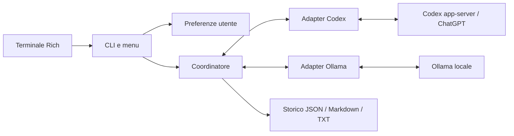

> Documento della versione 0.3, conservato come riferimento storico. I comandi operativi attuali sono descritti nel README principale.

# Architettura di AlterEcho

[Guida all'uso e installazione](README.md)

AlterEcho è un coordinatore Python 3.11+ con interfaccia Rich. Alterna due interlocutori attraverso adapter separati e salva una cronologia comune. Il testo delle risposte viene inoltrato integralmente; nomi dei modelli, tempi e contatori restano nell'interfaccia e nei file.

## Componenti



| File | Responsabilità |
| --- | --- |
| `alterecho/cli.py` | Parser, menu, avvio, ripresa, diagnostica e chiusura degli adapter |
| `alterecho/ui.py` | Selezioni numeriche, impostazioni, conferme, messaggi e riepiloghi Rich |
| `alterecho/config.py` | Configurazione, caricamento TOML e validazione |
| `alterecho/paths.py` | Percorsi personali indipendenti dalla cartella del terminale |
| `alterecho/preferences.py` | Preferenze persistenti, migrazione e ricerca degli storici |
| `alterecho/coordinator.py` | Alternanza, limite dei messaggi, checkpoint e gestione degli arresti |
| `alterecho/history.py` | Messaggi, ruoli, istruzioni e cronologia Ollama |
| `alterecho/adapters/base.py` | Protocollo comune `Adapter` e risultato `Reply` |
| `alterecho/adapters/codex.py` | Processo app-server, JSON RPC, thread e autenticazione ChatGPT |
| `alterecho/adapters/ollama.py` | API HTTP locali, streaming e gestione dei modelli residenti |
| `alterecho/adapters/chat_api.py` | API OpenAI/OpenRouter, cataloghi e streaming SSE senza strumenti |
| `alterecho/integrations.py` | Catalogo di profili adapter, validazione e riferimenti alle variabili delle chiavi |
| `alterecho/profile_runtime.py` | Preparazione e ripresa dei dialoghi con coppie di profili esplicite |
| `alterecho/storage.py` | JSON atomico, lettura, esportazione ed eliminazione degli storici |
| `alterecho/exporters/html.py` | Rendering Markdown sicuro e generazione della pagina HTML autonoma |
| `alterecho/exporters/templates/` | Template HTML, CSS e JavaScript incorporati nel file esportato |
| `alterecho/stats.py` | Aggregazione dei tempi e dei dati di utilizzo |
| `install-user.ps1`, `install-user.sh` | Launcher personali e configurazione del PATH con consenso |
| `tests/` | Mock degli adapter, test della CLI e server RPC simulato |

Gli adapter condividono `generate(conversation, checkpoint) -> Reply` e `close()`. `Reply` contiene testo, modello e usage disponibili. Connessione e preparazione sono specifiche del provider. Per aggiungere un provider occorre implementare il protocollo e integrare il suo avvio nella CLI.

Il menu mantiene **Nuova conversazione** al primo livello; ripresa, eliminazione e HTML sono nel sottomenu **Archivio conversazioni**. Le impostazioni sono raggruppate in **Conversazione**, **Modelli e adapter**, **Esecuzione e salvataggi**, **Diagnostica e manutenzione**. Dopo ogni operazione resta aperta la sezione corrente; **0** torna al livello precedente. Il gestore di profili Codex/Ollama/OpenAI/OpenRouter si trova in **Modelli e adapter → Adapter e integrazioni**. Un profilo seleziona un adapter implementato; registrare un endpoint non genera automaticamente un nuovo backend.

`adapters.json` ha schema 1 e conserva soltanto ID, nome, provider, modello, eseguibile, URL e nome della variabile d'ambiente. `Config.adapter_pair`, vuoto nelle configurazioni precedenti, contiene la copia dei profili selezionati. Le chiavi interne `codex` e `ollama` restano gli slot A/B per compatibilità con gli storici; il nome visualizzato e i modelli provengono dai profili. I riepiloghi e gli export riportano gli interlocutori effettivi.

Il percorso tradizionale resta disponibile se `adapter_pair` è vuoto. Con profili espliciti, il runtime costruisce solo gli adapter scelti e verifica i cataloghi. Codex resta in A; è consentito un solo modello locale Ollama. Le riprese usano le configurazioni registrate nella chat, non il catalogo corrente, e verificano il thread se presente. I provider HTTP ricostruiscono la memoria dalla cronologia canonica; un turno parziale non entra come risposta completa.

Le API remote usano gli endpoint HTTPS ufficiali, `/models` e `/chat/completions`, con redirect e proxy ambientali disabilitati. Lo streaming SSE conserva i parziali e legge gli usage senza stime; errori, limiti e richieste di strumenti fermano il ciclo. Le chiavi sono lette solo dall'ambiente al momento della richiesta e non passate al processo Codex. I parametri di ragionamento non sono inviati né modificati per le API; `api_max_output_tokens` limita la risposta con il campo previsto dal provider. Non vengono caricati plugin arbitrari né avviati server MCP; MCP è distinto dall'accesso ai provider API. Claude Code richiede un adapter dedicato non incluso qui.

## Ciclo di conversazione

1. La CLI carica e valida la configurazione.
2. Codex verifica l'account e restituisce il catalogo; Ollama elenca i modelli installati.
3. Nel menu l'utente sceglie i parametri essenziali e conferma. Nella ripresa si verifica prima il thread.
4. Il coordinatore sceglie il prossimo interlocutore dalla sequenza dello storico.
5. L'adapter genera una risposta; i parziali ricevuti vengono salvati durante lo streaming.
6. La risposta completa entra nello storico, viene salvata ed esportata, poi appare nel terminale.
7. Il ciclo termina al limite, a un errore o all'interruzione manuale.

Il limite conta **messaggi**, non coppie. Tra due generazioni può esserci un ritardo configurato. Nessun contenuto generato viene interpretato come comando.

### Modalità

`free` è il dialogo libero. `debate` assegna posizioni iniziali distinte, lasciando ai modelli la possibilità di cambiare opinione. `blind` omette l'identità esplicita dell'interlocutore dalle istruzioni: non impedisce ai modelli di dichiararla spontaneamente.

Argomento, personalità e posizioni sono istruzioni configurate separatamente dalle risposte inoltrate.

## Memoria e adapter

### Codex

L'adapter avvia `codex app-server --listen stdio:// --strict-config` e comunica mediante messaggi JSON strutturati, senza analizzare l'output visivo del terminale.

Il binario viene cercato nel PATH o nel percorso `codex_binary`. Su Windows, con il nome predefinito, vengono controllate anche le installazioni desktop sotto `%LOCALAPPDATA%/OpenAI/Codex/bin`. Un override esplicito errato non viene sostituito silenziosamente.

L'account viene controllato con `account/read`; `model/list` viene letto con paginazione. Il catalogo non garantisce quote o accesso per una futura generazione. Il ragionamento viene verificato rispetto ai livelli dichiarati dal modello.

`thread/start` crea la sessione, `thread/resume` la ripristina e `turn/start` riceve soltanto l'ultimo messaggio dell'altro interlocutore. Il contesto già presente nel thread non viene reinviato. Se Codex comincia, riceve un invito iniziale ad aprire il dialogo.

### Ollama

`/api/tags` elenca i modelli, `/api/show` permette di controllare il contesto dichiarato e `/api/chat` genera in streaming.

Ogni richiesta di chat contiene una sola istruzione di sistema e la cronologia completa: le risposte Ollama hanno ruolo `assistant`, quelle Codex ruolo `user`. Se Ollama comincia, viene incluso anche l'invito iniziale. La memoria viene ricostruita dallo storico anche quando il modello è scaricato dalla memoria.

Prima del dialogo, l'adapter acquisisce una sola fotografia di `/api/ps`, senza scaricare modelli altrui. `/api/chat` usa `think=false` invariato e `keep_alive=ollama_keep_alive`, predefinito `-1`. Sono accettati i valori interi `-1` e `0` e le stringhe `"5m"` e `"10m"`: un sottoinsieme esplicito dei formati ufficiali Ollama (secondi numerici e durate). Non c'è polling a ogni turno. Memoria insufficiente, altri client o il runtime possono ancora causare scaricamenti e ricaricamenti.

`ollama_unload_on_exit=true` richiede una pulizia finale soltanto se sicura. `close()` è idempotente, chiude sempre il client HTTP e non interviene sui modelli preesistenti. Dopo una generazione, se necessario, esegue un solo controllo finale `/api/ps` con timeout massimo di 5 secondi. Né l'assenza iniziale del modello né `expires_at` dimostrano l'uso esclusivo: l'API non espone lease, conteggi o identità dei client. Perciò, anche se caricato da AlterEcho, il modello condiviso viene lasciato residente e la CLI espone il motivo. L'opzione `false` disabilita anche questa verifica finale. Non esiste un percorso di scaricamento forzato automatico mascherato da controllo di proprietà. Errori di chiusura non annullano il salvataggio, e Ctrl+C passa dalla stessa chiusura ordinata; un arresto forzato del processo non la garantisce.

`load_duration` ed `eval_duration` (nanosecondi) vengono convertiti in `usage.load_seconds` e `usage.generation_seconds` per i nuovi messaggi. Sono visibili nel terminale e nel JSON, senza cambiare gli export HTML. Un valore di caricamento ridotto può includere overhead e non dimostra l'assenza assoluta di lavoro del runtime. Riferimenti: [chat](https://docs.ollama.com/api/chat), [modelli residenti](https://docs.ollama.com/api/ps), [keep_alive](https://docs.ollama.com/faq).

## Persistenza e ripresa

Il JSON è lo storico canonico. Contiene configurazione, ID della conversazione, data di creazione, messaggi, stato, errore eventuale, checkpoint del thread Codex, turno pendente e risposta parziale. Ogni nuova chat viene salvata in `output_dir/<conversation-id>/<conversation-id>.json`; Markdown, TXT e HTML sono affiancati. La scansione ricorsiva mantiene visibili anche gli storici precedenti salvati direttamente in `output_dir`.

Ogni messaggio registra interlocutore, modello, testo, timestamp UTC ISO 8601, durata e usage. La lettura verifica formato, ordine dei ruoli e coerenza del checkpoint.

Il salvataggio scrive un file temporaneo, esegue flush/fsync e lo sostituisce con `os.replace`. Il coordinatore salva prima di un turno e dopo ogni risposta; gli adapter effettuano checkpoint dei parziali circa ogni mezzo secondo. Markdown, TXT e HTML vengono aggiornati dopo le risposte complete e alla chiusura. JSON resta canonico ed è salvato prima degli export: un errore di rendering o scrittura può impedire l'aggiornamento di un export, ma non annulla il checkpoint JSON.

L'HTML è creato a partire dall'oggetto conversazione già caricato, senza alterare i messaggi. `markdown-it-py` usa il preset standard con HTML grezzo disabilitato; Pygments evidenzia localmente i blocchi di codice. Link cliccabili sono limitati a `http`, `https` e `mailto`; schemi non consentiti diventano link inerti. Le immagini Markdown vengono mostrate come testo alternativo senza `src`, evitando richieste automatiche.

Template, CSS e JavaScript vivono separati in `alterecho/exporters/templates/` e sono inclusi come package data. Il generatore calcola hash SHA-256 del CSS e del JavaScript incorporati e costruisce una CSP con `default-src 'none'`, `connect-src 'none'`, `img-src 'none'` e nessuna risorsa esterna. I controlli locali forniscono ricerca/evidenziazione, tema, copia e navigazione; nessun testo generato viene interpolato nel JavaScript. L'aggiornamento HTML usa la stessa scrittura atomica dei file di testo. La CSP riduce le capacità della pagina, ma un file HTML non è un contenitore isolato: i link HTTP/HTTPS diventano richieste soltanto quando l'utente li apre.

Le statistiche HTML sommano solo i campi effettivamente misurati. Il totale input/output descrive token elaborati, non token unici: i token di input possono includere più volte lo stesso contesto. La velocità media usa output misurati divisi per la durata dei rispettivi messaggi; se mancano i dati mostra “Non disponibile”.

Il comando `export` rigenera tutti i formati per impostazione predefinita, oppure accetta `--format md txt html` per limitare quelli prodotti. Nel menu la voce **Visualizza in HTML** mostra i dettagli della chat, aggiorna il file e lo apre nel browser dopo la selezione. I salvataggi durante un dialogo non aprono il browser. Al termine e dopo la continuazione di una chat vengono aggiornati JSON, Markdown, TXT e HTML nella stessa posizione.

Dal menu si può selezionare uno storico per eliminarlo. L'interfaccia chiede conferma prima di rimuovere il JSON canonico e i file `.md`, `.txt` e `.html` generati con lo stesso nome; gli altri file nella cartella non vengono toccati.

### Verifiche della ripresa

La ripresa richiede il thread Codex e l'account originali, i file di sessione presenti e i modelli disponibili. Si confrontano l'ultimo ID di turno e il testo dell'ultima risposta.

- Un turno Codex completato ma non ancora salvato può essere recuperato se input, ID e stato corrispondono.
- Un turno Codex incompleto, fuori sincronia o modificato esternamente viene rifiutato per evitare duplicazioni.
- Un thread vuoto senza alcun turno Codex può essere ricreato.
- Una generazione Ollama interrotta può essere riprovata dalla cronologia canonica.

Nel menu, annullare la conferma lascia intatto il JSON. L'eventuale recupero rimane in memoria fino alla conferma; i messaggi aggiuntivi vengono conteggiati dopo il recupero. La continuazione si salva accanto al file selezionato, usando i parametri della chat.

## Configurazione e percorsi

Il profilo utente è un JSON con versione dello schema, configurazione e cartelle degli storici ricordate. Cambiare cartella di salvataggio o ripristinare i valori predefiniti non elimina le chat.

Se il profilo manca, viene letto l'eventuale `config.toml` del checkout. Il primo salvataggio delle impostazioni o la conferma di un nuovo dialogo crea il profilo senza riscrivere il TOML. Un profilo non valido viene segnalato e preservato.

`--config` usa il TOML indicato senza sostituire il profilo. I suoi percorsi relativi partono dalla cartella del file; gli argomenti di percorso della CLI partono dalla cartella corrente del terminale.

| Parametri | Funzione |
| --- | --- |
| `topic`, `mode`, `first` | Argomento, modalità e primo interlocutore |
| `roles`, `positions` | Personalità e posizioni del dibattito |
| `max_turns`, `delay`, `timeout` | Messaggi totali, pausa e timeout |
| `codex_model`, `codex_effort` | Modello e ragionamento Codex |
| `codex_binary`, `codex_home` | Eseguibile e directory Codex esistente |
| `ollama_model`, `ollama_url` | Modello e endpoint HTTP loopback |
| `ollama_keep_alive`, `ollama_unload_on_exit` | Permanenza tra i turni e richiesta prudente di pulizia finale |
| `num_ctx`, `num_predict`, `temperature` | Contesto, massimo token di risposta e sampling Ollama |
| `ollama_options` | Opzioni aggiuntive, come `top_p` o `seed` |
| `output_dir`, `codex_work_dir` | Salvataggi e directory di lavoro Codex |

I valori iniziali includono contesto Ollama di 4096 token, risposte fino a 512 token, temperatura 0.7, ragionamento Codex `low` e timeout di 180 secondi. Il ragionamento scelto nel menu viene adattato se il modello non supporta il valore salvato. Il limite dei token Ollama lascia un margine di 256 token nel contesto.

Codex non espone tramite questa implementazione una temperature configurabile o un limite rigido universale dei token di risposta. Le istruzioni richiedono risposte brevi.

Su Windows configurazione e dati tecnici usano rispettivamente `%APPDATA%/AlterEcho` e `%LOCALAPPDATA%/AlterEcho`; su Linux `XDG_CONFIG_HOME` e `XDG_DATA_HOME`, con fallback a `~/.config/alterecho` e `~/.local/share/alterecho`. Le conversazioni nuove vanno invece in `Documenti/AlterEcho/conversations`: Windows risolve la cartella nativa con `SHGetFolderPathW(CSIDL_PERSONAL)` rispettando reindirizzamenti, Linux legge `XDG_DOCUMENTS_DIR` da `user-dirs.dirs` senza eseguire shell, macOS e i fallback usano `~/Documents`. Le preferenze che contenevano il vecchio percorso dati predefinito vengono adattate in memoria; percorsi personalizzati e TOML espliciti restano validi. La ricerca include le directory attuale, Documenti e dati precedenti. I file storici non vengono riscritti dal caricamento della configurazione.

`ALTERECHO_HOME`, se impostato, deve essere assoluto e ospita `config/config.json` e `data/`. La directory di lavoro predefinita è `data_dir/work/codex-dialogue`.

Il menu cerca gli storici nella cartella configurata, in quella dati standard, nelle cartelle ricordate e in `outputs/conversations` del checkout, eliminando i duplicati e ordinando per ultima modifica. I vecchi JSON senza `codex_work_dir` vengono ripresi cercando di preservare la directory di lavoro del progetto.

## Limiti, statistiche e arresti

Lo storico non viene tagliato o riassunto automaticamente e non esiste una guardia che tratta i byte UTF-8 come token. Ollama riceve `truncate=false` e `shift=false` per richiedere un errore al limite reale del contesto.

Contesto esaurito o compattazione Codex arrestano il dialogo. Una risposta Ollama al limite di generazione viene conservata come parziale e non inoltrata. Il campo legacy `codex_context_budget` rimane leggibile per compatibilità, ma non applica un limite.

I token Ollama derivano da `prompt_eval_count`/`eval_count`; i token al secondo da `eval_duration`, escluso il caricamento. Codex usa `thread/tokenUsage/updated` quando disponibile, senza inventare una velocità di generazione. Le statistiche sommano i campioni rilevati: assenza di campioni significa dato non disponibile.

Timeout, disconnessioni, stream incompleti, errori HTTP/RPC, autenticazione, quote o strumenti non autorizzati fanno fermare il coordinatore. Non ci sono retry automatici del coordinatore; eventuali tentativi interni della CLI restano soggetti al timeout. Ctrl+C tenta `turn/interrupt` e chiude app-server.

I comandi avanzati restituiscono 0 al completamento, 1 per errore/arresto e 130 per Ctrl+C. Il menu torna disponibile dopo un'operazione interrotta; Ctrl+C nel menu principale esce. Errori di sintassi del parser restituiscono 2.

## Sicurezza

- Codex usa l'autenticazione ChatGPT gestita dalla CLI. Account API key e provider alternativi sono rifiutati; `OPENAI_API_KEY`, `CODEX_API_KEY` e `OPENAI_BASE_URL` vengono rimossi dall'ambiente del processo figlio.
- AlterEcho non legge `auth.json`, non estrae token e non modifica il login. Su Windows può indicare al processo figlio la directory Codex già esistente, normalmente `%USERPROFILE%/.codex`.
- La sessione usa sandbox `read-only`, approvazioni `never` e strumenti disabilitati, inclusi shell, browser, plugin, app e MCP ereditati. Le richieste di strumenti o elementi di turno non autorizzati causano l'arresto.
- `--strict-config` fa fallire l'avvio quando la CLI non riconosce impostazioni. Le configurazioni personali non vengono riscritte.
- Ollama accetta soltanto HTTP loopback; proxy ambientali e redirect non vengono usati. AlterEcho non apre listener o espone Ollama su Internet.
- Le risposte dell'altro modello sono contenuto non attendibile, mai istruzioni di sistema. Il coordinatore non le esegue; la UI neutralizza i controlli terminale preservando il testo salvato e inoltrato.
- Non vengono acquistati crediti o attivati servizi di fatturazione.

Queste restrizioni appartengono all'harness Codex: non costituiscono un contenitore OS che impedisce ogni lettura del disco. La CLI continua a gestire i propri file di autenticazione e sessione.

## Packaging, compatibilità e test

L'unico entry point installato è `alterecho = alterecho.cli:main`; è disponibile anche `python -m alterecho`. Gli alias del marchio precedente sono rimossi.

Il launcher Windows copia l'eseguibile del virtualenv in `%LOCALAPPDATA%/AlterEcho/bin`. Quello Linux invoca il Python del virtualenv con percorso assoluto. Entrambi richiedono consenso per l'installazione e le modifiche persistenti al PATH; dopo uno spostamento occorre ricreare il virtualenv e reinstallare il launcher.

La compatibilità è stata verificata con le versioni usate durante lo sviluppo. Il supporto dei campi Ollama `truncate`/`shift` può dipendere dalla versione installata. Linux è predisposto; launcher e quoting sono stati provati sotto Git Bash, ma non su un host Linux.

Dalla cartella del progetto:

```powershell
.\.venv\Scripts\python.exe -m unittest discover -v
```

Su Linux usa `.venv/bin/python -m unittest discover -v`. La suite usa mock, fixture e un app-server simulato: non effettua conversazioni reali. Verifica memoria, ripresa, parziali, errori, sicurezza, menu, preferenze, percorsi e launcher Windows. Il test del launcher usa una directory temporanea senza cambiare il PATH persistente.

Una simulazione manuale si avvia con `alterecho demo --turns 4`. `smoke-test.toml` prepara invece una prova **reale** di due messaggi: consuma quote Codex e si avvia solo dopo una scelta esplicita dell'utente.

## Riferimenti

L'app-server è stato scelto per il controllo dei thread e delle notifiche JSON, mantenendo il coordinatore in Python. SDK TypeScript e `codex exec` non sono gli adapter implementati.

- [Codex CLI](https://learn.chatgpt.com/docs/cli)
- [Codex app-server](https://learn.chatgpt.com/docs/app-server)
- [Autenticazione Codex](https://learn.chatgpt.com/docs/auth)
- [Configurazione Codex](https://learn.chatgpt.com/docs/config-file/config-reference)
- [Ollama chat](https://docs.ollama.com/api/chat)
- [Ollama FAQ](https://docs.ollama.com/faq)
- [Codice sorgente dell'API Ollama](https://github.com/ollama/ollama/tree/main/api)
